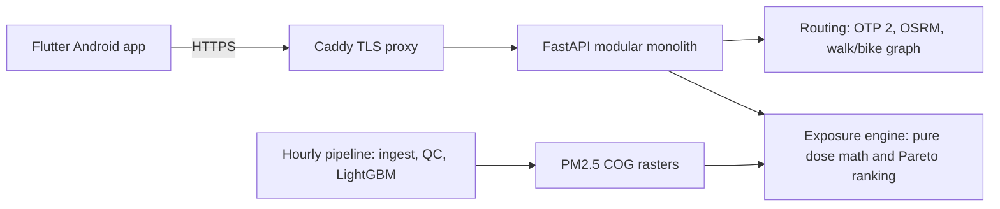

# Hirup

[](https://github.com/Faizalfadaa/Hirup/actions/workflows/ci.yml)
[](https://github.com/Faizalfadaa/Hirup/actions/workflows/deploy.yml)

**Hirup** ("breathe" in Bahasa Indonesia) is an Android app and Python backend that
plans multimodal trips in Jakarta and ranks them by the **PM2.5 dose you inhale**, not
only by travel time. It compares TransJakarta, MRT, LRT, walking and cycling, with
motorcycle and car shown as reference options, and uses an hourly LightGBM nowcast of
PM2.5 on a 100 m grid.

> Production API: `https://hirup.indonesiacentral.cloudapp.azure.com`
> ([health](https://hirup.indonesiacentral.cloudapp.azure.com/v1/health))

## Contents

- [Features](#features)
- [How it works](#how-it-works)
- [Architecture](#architecture)
- [Repository layout](#repository-layout)
- [Getting started](#getting-started)
- [API](#api)
- [Testing and CI](#testing-and-ci)
- [Deployment](#deployment)
- [Data, privacy and limitations](#data-privacy-and-limitations)
- [Contributing](#contributing)
- [Documentation](#documentation)

## Features

- **Exposure-aware route planning**: up to three labelled options per trip
  (*fastest*, *cleanest*, *balanced*), with per-leg dose and a cigarette equivalent.
- **Sensitivity profiles**: `umum` (general) and `rentan` (vulnerable groups) change
  the time-versus-dose trade-off.
- **Departure advice**: dose for each 15-minute departure slot within ±90 minutes.
- **Air-quality map and point lookup**: PM2.5 P10/P50/P90 at any point, map tiles and
  a 24-hour forecast.
- **City insight**: mean PM2.5 per kelurahan over a date range.
- **Honest data labelling**: every response states `data_quality`
  (`real`, `approximated` or `synthetic`).
- **Privacy by design**: no accounts, no background location, and the server does not
  keep trip origins or destinations.

## How it works

1. The user picks origin, destination, departure time, mode and sensitivity.
2. The backend generates candidates in parallel: OpenTripPlanner for transit, OSRM for
   car and motorcycle (motorcycles never use toll roads), and an in-process graph for
   walking and cycling legs that can detour around polluted streets.
3. PM2.5 is sampled every 25 m along each leg at the hour the traveller is there.
4. Dose per leg = mean PM2.5 × mode exposure factor × ventilation rate × duration.
   All constants come from [`contracts/exposure_params.yaml`](contracts/exposure_params.yaml),
   each with its source.
5. A Pareto filter on (duration, dose) selects and labels the options. Identical options
   share labels instead of appearing twice.

## Architecture



| Layer | Technology |
|---|---|
| Mobile | Flutter (stable), Riverpod, Dio, flutter_map |
| API | Python 3.12, FastAPI, Pydantic v2, httpx |
| Routing | OpenTripPlanner 2 (transit), OSRM (car, motorcycle), osmnx and rustworkx (active legs) |
| Air quality | LightGBM quantile models, rasterio Cloud-Optimized GeoTIFFs, DuckDB and Parquet |
| Infrastructure | Docker Compose, Caddy, Azure VM, GitHub Actions |

The backend has no server database; state lives in versioned files under `data/`.
Dependencies point one way: `api → routing → exposure`. See
[infra/BACKEND.md](infra/BACKEND.md) for the full design.

## Repository layout

| Path | Contents |
|---|---|
| [`apps/mobile/`](apps/mobile) | Flutter Android app |
| [`services/`](services) | FastAPI backend: `api`, `routing`, `exposure` |
| [`pipelines/`](pipelines), [`ml/`](ml) | Data ingest, QC, features, LightGBM training and raster publishing |
| [`contracts/`](contracts) | Frozen interface: OpenAPI, JSON schemas, exposure parameters, golden OD set |
| [`infra/`](infra) | Docker Compose, OTP and OSRM setup, deployment scripts and runbooks |
| [`tests/`](tests) | Integration and contract tests |
| [`data_prep/gtfs_manual/`](data_prep/gtfs_manual) | Manual MRT/LRT GTFS |
| [`fixtures/`](fixtures) | Seeded demo data |
| [`design/`](design), [`docs/`](docs) | Design exports and the technical specification |
| `data/` | Local data and models (gitignored) |

## Getting started

### Prerequisites

- Python 3.12 managed by [uv](https://docs.astral.sh/uv/)
- GNU Make
- Docker with Linux containers (for routing engines)
- Flutter stable and the Android SDK (for the app)
- Node.js, only for the optional Prism mock server

On Windows, use Git Bash and quote the repository path.

### Backend

```bash
make setup        # install the Python workspace
make api          # API on http://localhost:8000 (AQ and routing may return 503 without data)
make mock         # contract mock server on http://localhost:4010
```

Run `make help` to list every target. To run the full routing stack locally:

```bash
make -f infra/Makefile data-routing graphs active-graph   # download OSM/GTFS and build graphs
make -f infra/Makefile up smoke                           # start OTP and OSRM, then smoke test
make -f infra/Makefile backend-api                        # API on http://localhost:8002
```

Building graphs needs several GB of memory and disk; see [infra/README.md](infra/README.md).
For real air-quality data, set `HIRUP_DATA_DIR`, `HIRUP_AQ_PUBLICATION` and
`HIRUP_TRUNK_PENALTY` as described in the [P1/P2 handoff guide](infra/deploy/INTEGRATION.md).
Configuration names are listed in [`.env.example`](.env.example); never commit a filled `.env`.

For a clearly labelled synthetic demo without real AQ data:

```bash
export HIRUP_DEMO=true HIRUP_DEMO_MIN_PM25=10 HIRUP_DEMO_MAX_PM25=80
export HIRUP_DEMO_REFERENCE_PM25=40 HIRUP_TRUNK_PENALTY=2
make -f infra/Makefile backend-api
```

### Mobile app

```bash
cd apps/mobile
flutter pub get
flutter run --dart-define=API_BASE_URL=http://10.0.2.2:8000   # Android emulator to local API
```

Build a release APK against production:

```bash
flutter build apk --release --dart-define=API_BASE_URL=https://hirup.indonesiacentral.cloudapp.azure.com
```

The app also has an offline demo mode (long-press the logo on the home screen) that is
always labelled `MODE DEMO · DATA SIMULASI`. See [apps/mobile/README.md](apps/mobile/README.md).

## API

The contract is [`contracts/openapi.yaml`](contracts/openapi.yaml), exported from the
Pydantic models. Errors follow RFC 9457 Problem Details; requests outside the pilot area
return `404` with `type: out_of_service_area`.

| Method | Endpoint | Purpose |
|---|---|---|
| `POST` | `/v1/routes/plan` | Up to 3 labelled options plus motorcycle and car comparison |
| `GET` | `/v1/routes/departure-advice` | Dose per 15-minute departure slot within ±90 minutes |
| `GET` | `/v1/aq/point` | PM2.5 P10/P50/P90 at a point |
| `GET` | `/v1/aq/tiles/{z}/{x}/{y}.png` | PM2.5 map tile |
| `GET` | `/v1/aq/forecast` | Hourly PM2.5 forecast up to 24 hours |
| `GET` | `/v1/aq/daily-summary` | Daily mean PM2.5 and cigarette equivalent |
| `GET` | `/v1/insights/kelurahan` | Mean PM2.5 per kelurahan |
| `GET` | `/v1/greenspaces/nearby` | Nearest green spaces with PM2.5 |
| `GET` | `/v1/health` | Service status, model version and data age |

Example:

```bash
curl -X POST https://hirup.indonesiacentral.cloudapp.azure.com/v1/routes/plan \
  -H 'content-type: application/json' \
  -d '{"origin":{"lat":-6.2894,"lon":106.7742},"destination":{"lat":-6.2088,"lon":106.8227}}'
```

Plan requests are rate-limited per client IP.

## Testing and CI

```bash
make lint          # ruff check and format check
make typecheck     # mypy (strict) on services, pipelines and ml
make test          # unit tests, integration tests excluded
cd apps/mobile && flutter analyze && flutter test
```

Numerical code is tested against hand-computed values. The routing golden set in
[`contracts/golden_od.json`](contracts/golden_od.json) must keep returning options;
it needs the Docker engines:

```bash
make -f infra/Makefile golden-od
```

GitHub Actions:

- [`ci.yml`](.github/workflows/ci.yml): Python lint, types and tests, plus Flutter
  analyze and tests, on pushes and pull requests to `main` and `develop`.
- [`routing-golden.yml`](.github/workflows/routing-golden.yml): builds or restores
  routing graphs and runs the live golden OD checks.
- [`deploy.yml`](.github/workflows/deploy.yml): releases `main` to production after CI
  passes.

## Deployment

Production runs on a single Azure VM with Docker Compose (Caddy, API, OTP and two OSRM
profiles). An hourly systemd timer runs the air-quality pipeline and publishes new rasters.

Every merge to `main` that passes CI is deployed automatically. The workflow sends the
commit to the VM over a restricted SSH key, the VM builds an image tagged with the commit
SHA, and the release passes a health gate or rolls back to the previous image.

- [infra/deploy/AZURE.md](infra/deploy/AZURE.md): VM sizing and provisioning
- [infra/deploy/RUNBOOK.md](infra/deploy/RUNBOOK.md): bootstrap, releases, rollback and monitoring

## Data, privacy and limitations

- **Data quality**: production rejects synthetic AQ. Synthetic data is used only for
  tests and the labelled demo, and never feeds model metrics or impact figures.
- **Scientific constants** are read from [`contracts/exposure_params.yaml`](contracts/exposure_params.yaml);
  open items are tracked in [infra/PARAMETER_REVIEW.md](infra/PARAMETER_REVIEW.md).
- **Privacy** (UU PDP 27/2022): no accounts, no background location, route endpoints are
  snapped to 100 m cells, and exact origins and destinations are not stored or logged.
- **Data sources and licences** are listed in [docs/data_sources.md](docs/data_sources.md).
  The source code licence does not grant rights to redistribute third-party observations
  or feeds.
- **Known limitations**:
  - MRT/LRT GTFS is not yet included.
  - Late-night transit can be sparse, so planning may return `503`.
  - ISPU categories stay empty until the mapping is verified.

## Contributing

- `main` is protected. Work on a branch named `<lane>/<topic>`, open a pull request, and
  merge after CI passes and one teammate approves.
- Commit messages are a single Conventional Commits line, for example
  `feat(exposure): add per-leg dose and cigarette equivalent`.
- Files in `contracts/` are the interface between teams; change them only through the
  contract owner.
- Run lint, type checks and tests for every package you touch before opening a pull request.

## Documentation

- [docs/SPEC.md](docs/SPEC.md): product and technical specification
- [infra/BACKEND.md](infra/BACKEND.md): backend architecture and privacy
- [contracts/README.md](contracts/README.md): contract rules
- [docs/contracts-changelog.md](docs/contracts-changelog.md): contract history
- [pipelines/README.md](pipelines/README.md) and [ml/README.md](ml/README.md): data pipeline and model
