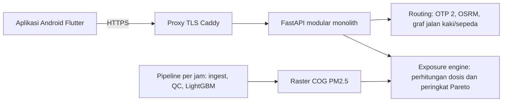

# Hirup

[](https://github.com/Faizalfadaa/Hirup/actions/workflows/ci.yml)
[](https://github.com/Faizalfadaa/Hirup/actions/workflows/deploy.yml)

**Hirup** adalah aplikasi Android dan backend Python untuk merencanakan perjalanan
multimoda di Jakarta. Rute diurutkan berdasarkan **dosis PM2.5 yang terhirup**, bukan
hanya waktu tempuh. Hirup membandingkan TransJakarta, MRT, LRT, jalan kaki, dan sepeda,
dengan sepeda motor dan mobil sebagai pembanding. Data PM2.5 berasal dari *nowcast*
LightGBM per jam pada grid 100 m.

> API produksi: `https://hirup.indonesiacentral.cloudapp.azure.com`
> ([health](https://hirup.indonesiacentral.cloudapp.azure.com/v1/health))

## Daftar isi

- [Fitur](#fitur)
- [Cara kerja](#cara-kerja)
- [Arsitektur](#arsitektur)
- [Struktur repositori](#struktur-repositori)
- [Memulai](#memulai)
- [API](#api)
- [Pengujian dan CI](#pengujian-dan-ci)
- [Deployment](#deployment)
- [Data, privasi, dan keterbatasan](#data-privasi-dan-keterbatasan)
- [Kontribusi](#kontribusi)
- [Dokumentasi](#dokumentasi)

## Fitur

- **Perencanaan rute berbasis paparan**: hingga tiga opsi berlabel per perjalanan
  (*tercepat*, *terbersih*, *seimbang*), lengkap dengan dosis per segmen dan padanan
  jumlah batang rokok.
- **Profil sensitivitas**: `umum` dan `rentan` (kelompok rentan) mengubah keseimbangan
  antara waktu dan dosis.
- **Saran waktu berangkat**: dosis untuk setiap slot keberangkatan 15 menit dalam
  rentang ±90 menit.
- **Peta dan cek kualitas udara**: PM2.5 P10/P50/P90 di titik mana pun, tile peta,
  dan prakiraan 24 jam.
- **Insight kota**: rata-rata PM2.5 per kelurahan dalam rentang tanggal tertentu.
- **Label data yang jujur**: setiap respons mencantumkan `data_quality`
  (`real`, `approximated`, atau `synthetic`).
- **Privasi sejak rancangan**: tanpa akun, tanpa lokasi di latar belakang, dan server
  tidak menyimpan titik asal maupun tujuan perjalanan.

## Cara kerja

1. Pengguna memilih asal, tujuan, waktu berangkat, moda, dan sensitivitas.
2. Backend membuat kandidat rute secara paralel: OpenTripPlanner untuk transit, OSRM
   untuk mobil dan sepeda motor (sepeda motor tidak pernah lewat jalan tol), serta graf
   internal untuk segmen jalan kaki dan sepeda yang bisa memutar menghindari jalan
   berpolusi.
3. PM2.5 diambil setiap 25 m di sepanjang segmen, pada jam ketika pengguna berada di sana.
4. Dosis per segmen = rata-rata PM2.5 × faktor paparan moda × laju ventilasi × durasi.
   Semua konstanta diambil dari [`contracts/exposure_params.yaml`](contracts/exposure_params.yaml)
   beserta sumbernya.
5. Filter Pareto pada (durasi, dosis) memilih dan memberi label opsi. Opsi yang identik
   digabung labelnya, tidak ditampilkan dua kali.

## Arsitektur



| Lapisan | Teknologi |
|---|---|
| Mobile | Flutter (stable), Riverpod, Dio, flutter_map |
| API | Python 3.12, FastAPI, Pydantic v2, httpx |
| Routing | OpenTripPlanner 2 (transit), OSRM (mobil, sepeda motor), osmnx dan rustworkx (segmen aktif) |
| Kualitas udara | Model kuantil LightGBM, Cloud-Optimized GeoTIFF via rasterio, DuckDB dan Parquet |
| Infrastruktur | Docker Compose, Caddy, Azure VM, GitHub Actions |

Backend tidak memakai database server; state disimpan sebagai file berversi di `data/`.
Arah dependensi satu arah: `api → routing → exposure`. Rancangan lengkap ada di
[infra/BACKEND.md](infra/BACKEND.md).

## Struktur repositori

| Path | Isi |
|---|---|
| [`apps/mobile/`](apps/mobile) | Aplikasi Android Flutter |
| [`services/`](services) | Backend FastAPI: `api`, `routing`, `exposure` |
| [`pipelines/`](pipelines), [`ml/`](ml) | Ingest data, QC, fitur, pelatihan LightGBM, dan publikasi raster |
| [`contracts/`](contracts) | Antarmuka beku: OpenAPI, JSON schema, parameter paparan, set golden OD |
| [`infra/`](infra) | Docker Compose, setup OTP dan OSRM, skrip deployment, dan runbook |
| [`tests/`](tests) | Tes integrasi dan kontrak |
| [`data_prep/gtfs_manual/`](data_prep/gtfs_manual) | GTFS MRT/LRT manual |
| [`fixtures/`](fixtures) | Data demo dengan seed |
| [`design/`](design), [`docs/`](docs) | Ekspor desain dan spesifikasi teknis |
| `data/` | Data dan model lokal (diabaikan git) |

## Memulai

### Prasyarat

- Python 3.12 yang dikelola dengan [uv](https://docs.astral.sh/uv/)
- GNU Make
- Docker dengan Linux container (untuk mesin routing)
- Flutter stable dan Android SDK (untuk aplikasi)
- Node.js, hanya untuk mock server Prism (opsional)

Di Windows, gunakan Git Bash dan beri tanda kutip pada path repositori.

### Backend

```bash
make setup        # instal workspace Python
make api          # API di http://localhost:8000 (AQ dan routing bisa 503 tanpa data)
make mock         # mock server kontrak di http://localhost:4010
```

Jalankan `make help` untuk melihat semua target. Untuk menjalankan stack routing lengkap
secara lokal:

```bash
make -f infra/Makefile data-routing graphs active-graph   # unduh OSM/GTFS dan bangun graf
make -f infra/Makefile up smoke                           # jalankan OTP dan OSRM, lalu smoke test
make -f infra/Makefile backend-api                        # API di http://localhost:8002
```

Membangun graf butuh memori dan disk beberapa GB; lihat [infra/README.md](infra/README.md).
Untuk data kualitas udara nyata, atur `HIRUP_DATA_DIR`, `HIRUP_AQ_PUBLICATION`, dan
`HIRUP_TRUNK_PENALTY` sesuai [panduan serah terima P1/P2](infra/deploy/INTEGRATION.md).
Nama konfigurasi tercantum di [`.env.example`](.env.example); jangan pernah commit `.env`
yang sudah terisi.

Untuk demo sintetis yang diberi label jelas, tanpa data AQ nyata:

```bash
export HIRUP_DEMO=true HIRUP_DEMO_MIN_PM25=10 HIRUP_DEMO_MAX_PM25=80
export HIRUP_DEMO_REFERENCE_PM25=40 HIRUP_TRUNK_PENALTY=2
make -f infra/Makefile backend-api
```

### Aplikasi mobile

```bash
cd apps/mobile
flutter pub get
flutter run --dart-define=API_BASE_URL=http://10.0.2.2:8000   # emulator Android ke API lokal
```

Build APK rilis yang terhubung ke server produksi:

```bash
flutter build apk --release --dart-define=API_BASE_URL=https://hirup.indonesiacentral.cloudapp.azure.com
```

Aplikasi juga punya mode demo offline (tekan lama logo di Beranda) yang selalu diberi
label `MODE DEMO · DATA SIMULASI`. Lihat [apps/mobile/README.md](apps/mobile/README.md).

## API

Kontrak API ada di [`contracts/openapi.yaml`](contracts/openapi.yaml), diekspor dari
model Pydantic. Error mengikuti RFC 9457 Problem Details; permintaan di luar area pilot
mengembalikan `404` dengan `type: out_of_service_area`.

| Metode | Endpoint | Fungsi |
|---|---|---|
| `POST` | `/v1/routes/plan` | Hingga 3 opsi berlabel plus pembanding sepeda motor dan mobil |
| `GET` | `/v1/routes/departure-advice` | Dosis per slot keberangkatan 15 menit dalam ±90 menit |
| `GET` | `/v1/aq/point` | PM2.5 P10/P50/P90 di suatu titik |
| `GET` | `/v1/aq/tiles/{z}/{x}/{y}.png` | Tile peta PM2.5 |
| `GET` | `/v1/aq/forecast` | Prakiraan PM2.5 per jam hingga 24 jam |
| `GET` | `/v1/aq/daily-summary` | Rata-rata PM2.5 harian dan padanan rokok |
| `GET` | `/v1/insights/kelurahan` | Rata-rata PM2.5 per kelurahan |
| `GET` | `/v1/greenspaces/nearby` | Ruang hijau terdekat beserta PM2.5-nya |
| `GET` | `/v1/health` | Status layanan, versi model, dan umur data |

Contoh:

```bash
curl -X POST https://hirup.indonesiacentral.cloudapp.azure.com/v1/routes/plan \
  -H 'content-type: application/json' \
  -d '{"origin":{"lat":-6.2894,"lon":106.7742},"destination":{"lat":-6.2088,"lon":106.8227}}'
```

Permintaan rute dibatasi (*rate limit*) per IP klien.

## Pengujian dan CI

```bash
make lint          # ruff check dan format check
make typecheck     # mypy (strict) untuk services, pipelines, dan ml
make test          # unit test, tanpa tes integrasi
cd apps/mobile && flutter analyze && flutter test
```

Kode numerik diuji dengan nilai yang dihitung manual. Set golden routing di
[`contracts/golden_od.json`](contracts/golden_od.json) harus selalu menghasilkan opsi;
pengujiannya membutuhkan mesin Docker:

```bash
make -f infra/Makefile golden-od
```

GitHub Actions:

- [`ci.yml`](.github/workflows/ci.yml): lint, cek tipe, dan tes Python, serta
  `flutter analyze` dan tes Flutter, pada push dan pull request ke `main` dan `develop`.
- [`routing-golden.yml`](.github/workflows/routing-golden.yml): membangun atau
  memulihkan graf routing dan menjalankan cek golden OD secara langsung.
- [`deploy.yml`](.github/workflows/deploy.yml): merilis `main` ke produksi setelah CI lulus.

## Deployment

Produksi berjalan di satu Azure VM dengan Docker Compose (Caddy, API, OTP, dan dua profil
OSRM). Timer systemd per jam menjalankan pipeline kualitas udara dan memublikasikan raster
baru.

Setiap merge ke `main` yang lulus CI langsung di-deploy otomatis. Workflow mengirim commit
ke VM lewat kunci SSH terbatas, VM membangun image bertag SHA commit, lalu rilis harus
lolos pemeriksaan kesehatan atau otomatis kembali (*rollback*) ke image sebelumnya.

- [infra/deploy/AZURE.md](infra/deploy/AZURE.md): ukuran dan penyiapan VM
- [infra/deploy/RUNBOOK.md](infra/deploy/RUNBOOK.md): bootstrap, rilis, rollback, dan monitoring

## Data, privasi, dan keterbatasan

- **Kualitas data**: produksi menolak data AQ sintetis. Data sintetis hanya dipakai untuk
  tes dan mode demo berlabel, dan tidak pernah dipakai untuk metrik model atau angka dampak.
- **Konstanta ilmiah** dibaca dari [`contracts/exposure_params.yaml`](contracts/exposure_params.yaml);
  hal yang masih terbuka dicatat di [infra/PARAMETER_REVIEW.md](infra/PARAMETER_REVIEW.md).
- **Privasi** (UU PDP 27/2022): tanpa akun, tanpa lokasi di latar belakang, titik rute
  dibulatkan ke sel 100 m, dan asal serta tujuan persis tidak disimpan maupun dicatat di log.
- **Sumber data dan lisensi** tercantum di [docs/data_sources.md](docs/data_sources.md).
  Lisensi kode sumber tidak memberi hak untuk mendistribusikan ulang observasi atau feed
  dari pihak ketiga.
- **Keterbatasan yang diketahui**:
  - GTFS MRT/LRT belum disertakan.
  - Layanan transit larut malam bisa jarang, sehingga perencanaan rute dapat mengembalikan `503`.
  - Kategori ISPU masih kosong sampai pemetaannya terverifikasi.

## Kontribusi

- Branch `main` dilindungi. Kerjakan di branch bernama `<lane>/<topik>`, buka pull
  request, lalu merge setelah CI lulus dan satu rekan tim menyetujui.
- Pesan commit berupa satu baris Conventional Commits, misalnya
  `feat(exposure): add per-leg dose and cigarette equivalent`.
- File di `contracts/` adalah antarmuka antartim; ubah hanya melalui pemilik kontrak.
- Jalankan lint, cek tipe, dan tes untuk setiap paket yang kamu ubah sebelum membuka
  pull request.

## Dokumentasi

- [docs/SPEC.md](docs/SPEC.md): spesifikasi produk dan teknis
- [infra/BACKEND.md](infra/BACKEND.md): arsitektur backend dan privasi
- [contracts/README.md](contracts/README.md): aturan kontrak
- [docs/contracts-changelog.md](docs/contracts-changelog.md): riwayat perubahan kontrak
- [pipelines/README.md](pipelines/README.md) dan [ml/README.md](ml/README.md): pipeline data dan model
