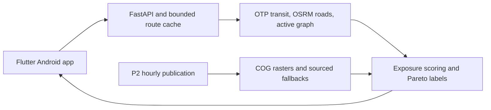

# Hirup

Android app (Flutter) and Python backend that plan multimodal trips in Jakarta (TransJakarta, MRT, LRT, walking, cycling, with motorcycle and car as comparisons) and rank them by inhaled PM2.5 dose, not only travel time. The technical specification is in `docs/SPEC.md`.

## Repository

| Path | Owner | Contents |
|---|---|---|
| `apps/mobile/` | P3 | Flutter app |
| `contracts/` | P1 | Frozen API contract, schemas, exposure parameters, golden OD |
| `services/` | P1 | FastAPI backend: `api`, `routing`, `exposure` |
| `infra/` | P1 | Docker Compose, OTP, OSRM |
| `tests/` | P1 | Integration and contract tests |
| `ml/`, `pipelines/` | P2 | PM2.5 model, ingest and features |
| `data_prep/gtfs_manual/` | P4 | MRT/LRT GTFS |
| `fixtures/` | P3 | Seeded demo data |
| `design/`, `docs/` | P4 | Figma exports, specification |
| `data/` | | Local data, gitignored |

## Current state

Backend routing, exposure, forecast/advice, daily summary and kelurahan adapters
are implemented on `develop`, together with P2's pipeline/model source. Actual
model binaries and real published AQ inputs must be transferred separately.
Missing production data produces degraded health or documented 503 responses.
The mobile app and manual MRT/LRT feeds have not been delivered in this branch.

This is the technical README draft. Final screenshots, APK, video, deck, Figma,
confirmed AI-assistant roles and the real 50-OD impact report remain pending.
No fixture results here are model-accuracy or public-health-impact claims.

## Solution flow

The user chooses origin, destination, time, mode and sensitivity. The backend
generates route candidates, optimizes active legs, samples hourly PM2.5 every
25 m, computes per-leg inhaled dose, and selects fastest/cleanest/balanced labels.
Identical options share labels. Motorcycle and car are comparison modes.



See [architecture and privacy](infra/BACKEND.md), the [specification](docs/SPEC.md),
and the [frozen API contract](contracts/openapi.yaml).

## Development checks

Requires Python 3.12 managed by `uv`, GNU Make, Docker with Linux containers,
and Node only for the optional Prism mock. On Windows use Git Bash and quote
the repository path. Follow [routing requirements](infra/README.md) for memory
and disk; production OTP uses an 8 GB heap on the planned 16 GB VM.

```bash
make help
make setup
make lint typecheck test
make -f infra/Makefile infra-check
```

The Python workspace includes backend, pipelines and ML. Tests use small seeded
fixtures; generated data/models stay under ignored `data/`. Frozen contracts
must not be regenerated casually with `make contract`.

## Run the backend

For an API process without configured AQ (health works, AQ/routing may return
503), use `make api` on port 8000. It requires no data-provider credentials to
start. Use `make mock` for the separate contract mock on port 4010.
Stop a `make api` process before starting Compose, whose placeholder also uses
port 8000. The separate `backend-api` target below uses port 8002.

Prepare routing inputs once, then start the engine stack:

```bash
make -f infra/Makefile data-routing graphs active-graph
make -f infra/Makefile up smoke
```

The first command downloads real OSM/GTFS and builds graphs; allow time, disk
and memory as documented in [infra](infra/README.md). The development Compose
API service is a placeholder. Run the actual application separately with
`make -f infra/Makefile backend-api` on port 8002. Existing engine host defaults
are OTP 18080, car 5000 and motorcycle 5001.

For sourced production-style AQ, set `HIRUP_DATA_DIR`, `HIRUP_AQ_PUBLICATION`
and the agreed `HIRUP_TRUNK_PENALTY` in the process environment, and use the
[P1/P2 handoff guide](infra/deploy/INTEGRATION.md). Provider key/configuration
names are listed in [.env.example](.env.example); never commit a filled file.
The Make targets do not automatically load a local `.env` into the API process.

For an explicitly synthetic routing/point demo, in a separate terminal:

```bash
export HIRUP_DEMO=true
export HIRUP_DEMO_MIN_PM25=10 HIRUP_DEMO_MAX_PM25=80
export HIRUP_DEMO_REFERENCE_PM25=40 HIRUP_TRUNK_PENALTY=2
make -f infra/Makefile backend-api
```

These are seeded demonstration inputs, not verified ambient concentrations or
production routing assumptions. This mode does not create every forecast or
kelurahan artifact. The Android offline five-scenario demo belongs to the mobile
lane and still needs its actual assets.

## Integration and CI

```bash
make -f infra/Makefile golden-od GOLDEN_ARGS="--date 2026-10-14 --demo-min-pm25 10 --demo-max-pm25 80 --reference-pm25 40 --trunk-penalty 2 --cold-cache --profile-stages --output data/benchmarks/golden.json"
uv run python -m tests.integration.p2_runner
```

Both commands require running Docker engines and the prepared active graph.
The second trains a seeded toy model and reads its synthetic-labelled COGs.
The fixed date is a test scenario; ensure the staged GTFS covers it. Reports
remain ignored and are never a replacement for the real 50-OD impact study.

Regular CI checks pushes/PRs to `main` and `develop`, with a manual trigger.
The separate [routing golden workflow](.github/workflows/routing-golden.yml)
builds or restores checksummed graphs and runs live HTTP/golden tests. Linux
build containers use the host UID/GID so graph artifacts remain writable.
Candidate coverage and numerical formulas are not reduced to meet latency goals.

## Deployment, sources and limitations

Use [Azure preparation](infra/deploy/AZURE.md) to choose an available VM and
budget, then the [deployment runbook](infra/deploy/RUNBOOK.md). Actual cloud
provisioning, real AQ handoff and public server acceptance are still required.
The current file-based backend does not require Neon, Supabase or PostGIS.

Data-source/license records are in [data sources](docs/data_sources.md).
Verify each provider's redistribution terms; source code does not grant rights
to redistribute observations, feeds or model training inputs.

Every API data response identifies `real`, `approximated` or `synthetic` quality.
Production rejects synthetic AQ. Scientific inputs still require human review:
[parameter review queue](infra/PARAMETER_REVIEW.md). Unverified ISPU tiles are
unavailable; inequality indices and missing sourced costs/CO2/daily-share fields
remain null. The server uses approximate 100 m route endpoints and does not
persist exact user OD or request URLs in configured access logs.

LightGBM quantile models provide AQ predictions in the product. Human review
must confirm the final list of development assistants and their roles before
submission. Registered model metrics need their original validation evidence;
toy training and successful integration tests do not reproduce those metrics.
