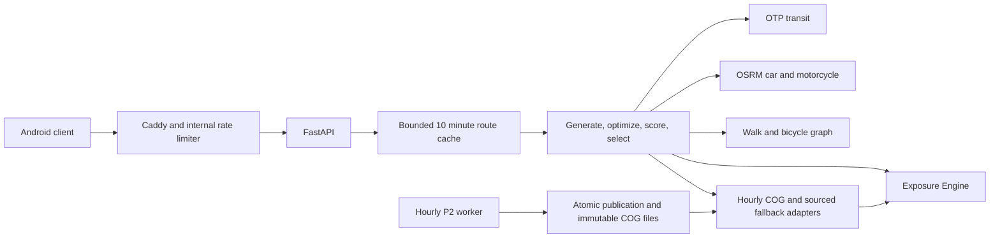

# Backend architecture and acceptance

The current implementation is a Python modular monolith with external routing
engines. The exposure/ranking core is pure; HTTP, raster and file access are edges.
P2 trains and publishes AQ data; the API does not train a model during a request.

## Request behavior

1. Validate the pilot bounds, requested time, mode and profile. Out-of-area
   requests return RFC 9457 Problem Details with `out_of_service_area`/404.
2. Use the approved approximate origin/destination centers of 100 m cells. Cache
   identity includes time and preferences; distinct precise transit times do not
   silently share a result. Concurrent identical requests share pending work.
3. Generate OTP variants and OSRM alternatives concurrently. Per-phase HTTP
   timeouts and total request deadlines bound external I/O; cancelled callers
   propagate cancellation. A slow variant cannot discard successful variants.
4. Optimize active legs with the cached hourly graph, keeping detour limits.
   Sample polylines every 25 m and compute dose with the frozen parameters.
5. Select Pareto options and merge identical labels. Serialize per-leg dose,
   uncertainty, comparison assumptions and data quality. Missing sourced factors
   remain null; unavailable AQ is a documented 503, not fabricated data.

The hourly owner thread manages COG open/reload/close. It validates an atomic
publication before switching inputs and invalidating route caches. Failed refresh
preserves the prior valid publication; absent startup data can recover later.
Future advice/forecast needs corrected forecasts or labelled historical fallback.
Complete-day summaries never silently average a partial day.

## Privacy implementation and limits

No account or server-side travel-history feature is implemented. Planning uses
approximate cell centers; the process retains bounded cached results for ten
minutes. Exact request OD is not written to storage or access logs. Production
proxy/API configuration disables URL access logging, and tests check a query
canary does not appear in logs. Review operational tooling so added monitoring
does not record URLs or request bodies.

This describes engineering behavior, not a legal compliance certification.
The device owns user-confirmed history, favorites and deletion controls; verify
their implementation with the mobile owner before claiming complete end-to-end
privacy behavior.

## Validation and performance

Use `make lint typecheck test` and `make -f infra/Makefile infra-check` for local
checks. The root suite includes P2 workspace tests and frozen OpenAPI checks.
See [infra README](README.md) for bounded live HTTP, golden and cache/burst runs.

Cold application-cache golden tests cover 10 OD x 3 slots with real Docker
routing and explicitly seeded synthetic AQ. Successful bounded JVM initialization
is reported separately; measured cases are not retried. Cache hits, failed cases,
stage profiles and p50/p95 must stay visible. Overlapping stage wall times must
not be added as if they were serial work.

Targets are plan p95 <=5 s (Must), <=3 s (Should), and AQ point <=500 ms.
Single successful local runs do not establish consistent production latency.
Test startup, refresh, steady state and concurrency on the target VM. The 50-OD
impact study must use real AQ and independently reviewed input parameters.

## Remaining acceptance gates

- Reviewed changes published on the integration branch and green hosted CI.
- Hosted golden cache-miss and cache-hit runs, including real graph build.
- Real P2 artifacts, actual device and MRT/LRT-feed handoff.
- Human verification of scientific inputs and approved inequality methodology.
- Public VM/TLS/timer/reboot/rollback checks and real-data latency evidence.
- Real 50-OD impact report, final submission assets and APK release.

The deployment package, [Azure preparation](deploy/AZURE.md) and
[parameter review](PARAMETER_REVIEW.md) make these gates explicit. They do not
claim those gates have already passed.
